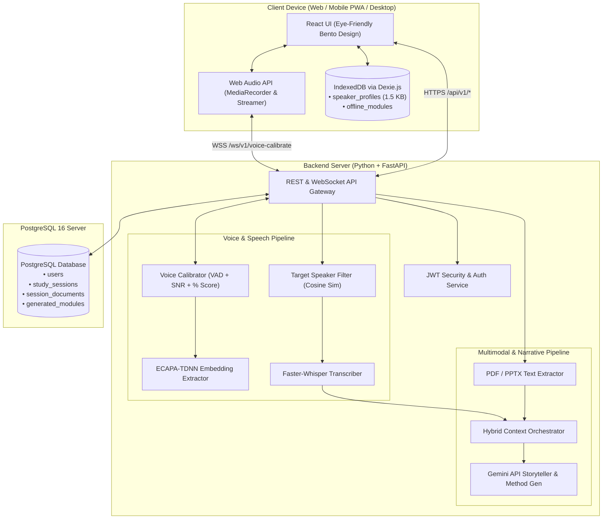
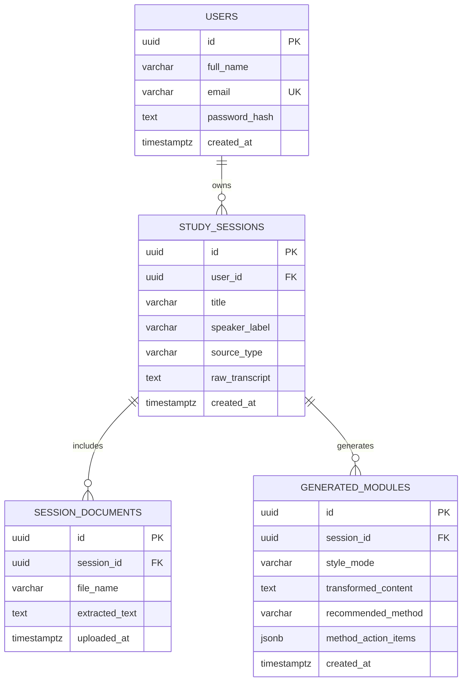

# 🏗️ SYSTEM ARCHITECTURE & DATABASE DESIGN
**Proyek:** NarraLearn AI

---

## 1. Tech Stack Terpilih

| Lapisan Sistem | Teknologi | Peran & Alasan Pemilihan |
| :--- | :--- | :--- |
| **Frontend & PWA** | **React 18 + TypeScript + Vite + Tailwind CSS** | Ekosistem cepat dan ringan untuk interaksi *real-time* (animasi kalibrasi suara, perekam audio) dengan dukungan `vite-plugin-pwa` untuk instalasi Mobile & Desktop. |
| **Client Local Storage** | **IndexedDB (via Dexie.js)** | Menyimpan vektor *voice embedding* (~1.5 KB/profil), label nama dosen, dan *cache* bacaan offline secara asinkron tanpa membebani memori utama. |
| **Backend Framework** | **Python 3.11 + FastAPI** | Performa tinggi untuk REST API dan WebSocket *real-time*, serta integrasi native dengan pustaka pemrosesan audio dan AI Python. |
| **Voice Biometrics** | **SpeechBrain (ECAPA-TDNN) + Silero VAD** | Mendeteksi aktivitas vokal (*Voice Activity Detection*), mengukur SNR, mengekstrak *voice fingerprint*, dan menghitung kemiripan suara (*Cosine Similarity*). |
| **Speech-to-Text** | **Faster-Whisper (CTranslate2)** | Transkripsi audio berkecepatan tinggi dengan akurasi tinggi untuk bahasa Indonesia dan istilah akademis bahasa Inggris. |
| **Document Parser** | **PyMuPDF (`fitz`) & `python-pptx`** | Ekstraksi teks yang cepat dan bersih dari file slide kuliah PDF maupun PowerPoint. |
| **Generative AI** | **Google Gemini 2.5 Flash / Pro API** | *Context window* sangat besar untuk menggabungkan dokumen puluhan halaman dan transkrip panjang menjadi narasi terstruktur (*Structured JSON Output*). |
| **Primary Database** | **PostgreSQL 16 + SQLAlchemy (Async) + Alembic** | Database relasional tangguh dengan dukungan tipe data `UUID` dan `JSONB` untuk menyimpan struktur kuis dan metode belajar secara fleksibel. |
| **Containerization** | **Docker & Docker Compose** | Menyatukan PostgreSQL, Backend, dan Frontend dalam satu lingkungan yang mudah dijalankan. |

---

## 2. Diagram Arsitektur Sistem



---

## 3. Skema Database PostgreSQL (ERD & DDL)



### SQL Migration Script (PostgreSQL)
```sql
CREATE EXTENSION IF NOT EXISTS "pgcrypto";

CREATE TABLE users (
    id UUID PRIMARY KEY DEFAULT gen_random_uuid(),
    full_name VARCHAR(100) NOT NULL,
    email VARCHAR(150) UNIQUE NOT NULL,
    password_hash TEXT NOT NULL,
    created_at TIMESTAMP WITH TIME ZONE DEFAULT CURRENT_TIMESTAMP
);

CREATE TABLE study_sessions (
    id UUID PRIMARY KEY DEFAULT gen_random_uuid(),
    user_id UUID NOT NULL REFERENCES users(id) ON DELETE CASCADE,
    title VARCHAR(200) NOT NULL,
    speaker_label VARCHAR(100),
    source_type VARCHAR(20) NOT NULL CHECK (source_type IN ('AUDIO', 'DOCUMENT', 'HYBRID')),
    raw_transcript TEXT,
    created_at TIMESTAMP WITH TIME ZONE DEFAULT CURRENT_TIMESTAMP
);

CREATE TABLE session_documents (
    id UUID PRIMARY KEY DEFAULT gen_random_uuid(),
    session_id UUID NOT NULL REFERENCES study_sessions(id) ON DELETE CASCADE,
    file_name VARCHAR(255) NOT NULL,
    extracted_text TEXT NOT NULL,
    uploaded_at TIMESTAMP WITH TIME ZONE DEFAULT CURRENT_TIMESTAMP
);

CREATE TABLE generated_modules (
    id UUID PRIMARY KEY DEFAULT gen_random_uuid(),
    session_id UUID NOT NULL REFERENCES study_sessions(id) ON DELETE CASCADE,
    style_mode VARCHAR(30) NOT NULL CHECK (style_mode IN ('GAMING', 'SOSMED', 'NOVEL', 'CASUAL_STORY')),
    transformed_content TEXT NOT NULL,
    recommended_method VARCHAR(100) NOT NULL,
    method_action_items JSONB NOT NULL,
    created_at TIMESTAMP WITH TIME ZONE DEFAULT CURRENT_TIMESTAMP
);

CREATE INDEX idx_sessions_user_id ON study_sessions(user_id);
CREATE INDEX idx_modules_session_id ON generated_modules(session_id);
```

---

## 4. Spesifikasi Endpoint API

| Method | Endpoint | Protokol | Deskripsi |
| :--- | :--- | :--- | :--- |
| `POST` | `/api/v1/auth/register` | HTTPS | Mendaftarkan pengguna baru. |
| `POST` | `/api/v1/auth/login` | HTTPS | Autentikasi pengguna dan mengembalikan JWT. |
| `WS` | `/ws/v1/voice-calibrate` | WSS | Menerima *stream* audio sampel secara *real-time*, mengirim progres `0%–100%`, dan mengembalikan `embeddingVector` final. |
| `POST` | `/api/v1/sessions/process` | HTTPS | Memproses unggahan Audio + Dokumen + `embeddingVector` + `style_mode` menjadi modul cerita & metode belajar. |
| `POST` | `/api/v1/sessions/{id}/switch-style` | HTTPS | Menghasilkan gaya narasi baru dari transkrip & teks dokumen yang sudah tersimpan di PostgreSQL. |
| `GET` | `/api/v1/sessions` | HTTPS | Mengambil daftar seluruh sesi belajar pengguna. |
| `GET` | `/api/v1/sessions/{id}` | HTTPS | Mengambil detail sesi beserta seluruh variasi gaya narasi yang pernah dibuat. |