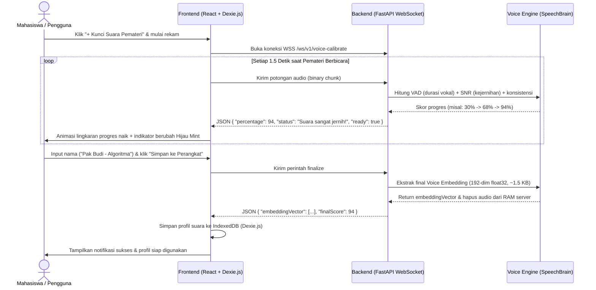
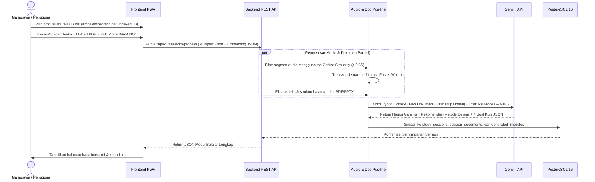
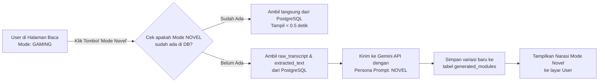

# ⚙️ SYSTEM WORKFLOWS & SEQUENCE DIAGRAMS
**Proyek:** NarraLearn AI

---

## 1. Workflow 1: Kalibrasi & Penyimpanan Profil Suara Lokal (`0%–100%`)

Alur ini menjelaskan bagaimana aplikasi mengenali suara dosen/pemateri secara *real-time* dan menyimpannya ke perangkat pengguna tanpa membebani server.

### Formula Perhitungan Persentase Kalibrasi
$$\text{Total Score (\%)} = (0.50 \times \text{ActiveSpeechScore}) + (0.30 \times \text{SNRQualityScore}) + (0.20 \times \text{EmbeddingStability})$$
* **Active Speech (50%):** Mencapai nilai penuh setelah tertangkap minimal 8 detik suara manusia bersih.
* **SNR Quality (30%):** Mengukur kejernihan suara terhadap kebisingan kelas.
* **Embedding Stability (20%):** Memastikan hanya ada satu suara dominan yang konsisten terekam.

---

## 2. Workflow 2: Pemrosesan Materi Multimodal & Transformasi AI

Alur ini menjelaskan penggabungan suara dosen yang sudah difilter dengan slide PDF/PPTX, lalu mengubahnya menjadi narasi pilihan pengguna.

---

## 3. Workflow 3: Instant Style Switching (Ganti Gaya Tanpa Rekam Ulang)

