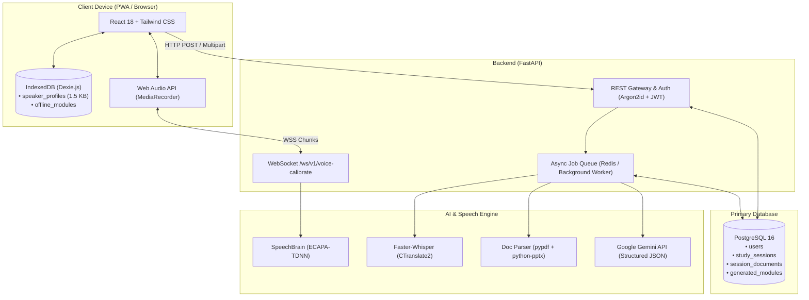

# 📑 NarraLearn AI — Rangkuman Analisis & Rencana Eksekusi Proyek (Revised Master Plan)
**Dokumen Referensi:** `C:\NarraLearn\Plan\1_*.md` s/d `7_*.md`  
**Target Platform:** Progressive Web App (PWA) — Web, Android, iOS, Desktop  
**Tanggal Analisis:** 16 November 2026  
**Status Evaluasi:** Perencanaan Matang (Execution-Ready dengan Penyesuaian Arsitektur)

---

## 1. Executive Summary & Skor Kesiapan Sistem

Dokumen perencanaan **NarraLearn AI** telah dievaluasi dari berbagai sudut pandang arsitektur, kelayakan teknis AI/ML, efisiensi database relasional murni, dan pengalaman pengguna (*UI/UX*). Secara konseptual dan visual, rancangan proyek ini sangat solid dan terarah.

### Matriks Skor Kesiapan

| Komponen Perencanaan | Skor | Status | Catatan Utama |
| :--- | :---: | :---: | :--- |
| **Product Requirements (PRD)** | **8.5 / 10** | Siap | Persona Gen-Z/pelajar dan 4 mode narasi terdefinisi tajam. |
| **Design System & UI/UX** | **8.0 / 10** | Siap | *Bento grid*, tema *Midnight Slate/Warm Oat*, dan kontras WCAG AA. |
| **Relational Database Design** | **7.5 / 10** | Siap | Skema PostgreSQL 16 murni (`UUID` + `JSONB`) tanpa vendor lock-in. |
| **Voice Biometrics Pipeline** | **6.0 / 10** | Penyesuaian | Perlu mitigasi latensi inferensi streaming audio chunks pada server. |
| **Multimodal Ingestion & STT** | **6.5 / 10** | Penyesuaian | Endpoint proses sinkron harus diubah ke model antrean (*Task Queue*). |
| **Roadmap & SDLC (Timeline)** | **6.0 / 10** | Penyesuaian | Target 8 minggu direvisi menjadi 10 minggu untuk stabilitas sistem. |

---

## 2. Temuan Kritis & Rekomendasi Solusi Teknis (*Technical Gaps*)

### A. Pola Pemrosesan Audio Durasi Panjang (Long-Running Tasks)
* **Masalah:** Endpoint `POST /api/v1/sessions/process` dirancang memproses rekaman kuliah panjang (hingga 60–120 menit) digabung file slide secara sinkron dalam satu siklus HTTP request.
* **Risiko:** *Gateway Timeout* (HTTP 504), browser freeze, serta konsumsi memori server melonjak saat beberapa pengguna mengunggah bersamaan.
* **Solusi Terstruktur:**
  1. Ubah endpoint menjadi **Asinkron**: kembalikan respon HTTP `202 Accepted` bersama `job_id`.
  2. Gunakan **Task Queue / Background Worker** (FastAPI `BackgroundTasks` / Celery / ARQ dengan Redis).
  3. Klien memantau status secara berkala (*polling*) atau menerima notifikasi status via WebSocket / SSE.

### B. Optimalisasi WebSocket Voice Calibration (0%–100%)
* **Masalah:** Mengirim potongan audio biner setiap 1.5 detik ke model ECAPA-TDNN di server untuk kalkulasi progres kalibrasi vokal.
* **Risiko:** Beban komputasi CPU/GPU server tinggi bila banyak pengguna melakukan kalibrasi serentak di kelas yang sama.
* **Solusi Terstruktur:**
  * Lakukan pra-kalkulasi durasi vokal (*VAD*) dan *Signal-to-Noise Ratio (SNR)* sederhana di browser menggunakan **Web Audio API**.
  * Server hanya menjalankan inferensi embedding 192-dimensi final setelah ambang batas suara bersih (minimal 8–10 detik) terpenuhi.

### C. Mitigasi Lisensi Pustaka Parser Dokumen
* **Masalah:** Arsitektur awal menyebutkan penggunaan **PyMuPDF (`fitz`)**.
* **Risiko:** PyMuPDF berada di bawah lisensi ketat **GNU AGPL-3.0** (atau lisensi komersial berbayar), yang berisiko mewajibkan pembukaan kode sumber (*copyleft*) jika dijadikan platform SaaS komersial.
* **Solusi Terstruktur:**
  * Ganti dengan pustaka berlisensi permisif seperti **`pypdf`** (BSD License) atau **`pdfplumber`** (MIT License) untuk ekstraksi teks dokumen PDF.

### D. Keamanan Format Output LLM (Gemini API)
* **Masalah:** Output AI harus memuat narasi panjang, rekomendasi metode belajar, dan 3–5 kartu kuis interaktif tanpa parsing error.
* **Solusi Terstruktur:**
  * Wajib memanfaatkan fitur **Structured Outputs / Response Schema** resmi Gemini API (menggunakan skema Pydantic) untuk menjamin format JSON kuis selalu valid saat di-render frontend.

---

## 3. Desain Arsitektur & Skema Database Final

### A. Alur Sistem Terintegrasi


### B. Skema Tabel PostgreSQL (DDL Baseline)
```sql
CREATE EXTENSION IF NOT EXISTS "pgcrypto";

-- 1. Tabel Pengguna
CREATE TABLE users (
    id UUID PRIMARY KEY DEFAULT gen_random_uuid(),
    full_name VARCHAR(100) NOT NULL,
    email VARCHAR(150) UNIQUE NOT NULL,
    password_hash TEXT NOT NULL,
    created_at TIMESTAMP WITH TIME ZONE DEFAULT CURRENT_TIMESTAMP
);

-- 2. Tabel Sesi Belajar
CREATE TABLE study_sessions (
    id UUID PRIMARY KEY DEFAULT gen_random_uuid(),
    user_id UUID NOT NULL REFERENCES users(id) ON DELETE CASCADE,
    title VARCHAR(200) NOT NULL,
    speaker_label VARCHAR(100),
    source_type VARCHAR(20) NOT NULL CHECK (source_type IN ('AUDIO', 'DOCUMENT', 'HYBRID')),
    processing_status VARCHAR(20) DEFAULT 'COMPLETED' CHECK (processing_status IN ('QUEUED', 'PROCESSING', 'COMPLETED', 'FAILED')),
    raw_transcript TEXT,
    created_at TIMESTAMP WITH TIME ZONE DEFAULT CURRENT_TIMESTAMP
);

-- 3. Tabel Dokumen Sumber (PDF / PPTX)
CREATE TABLE session_documents (
    id UUID PRIMARY KEY DEFAULT gen_random_uuid(),
    session_id UUID NOT NULL REFERENCES study_sessions(id) ON DELETE CASCADE,
    file_name VARCHAR(255) NOT NULL,
    extracted_text TEXT NOT NULL,
    uploaded_at TIMESTAMP WITH TIME ZONE DEFAULT CURRENT_TIMESTAMP
);

-- 4. Tabel Modul Narasi Hasil Transformasi AI
CREATE TABLE generated_modules (
    id UUID PRIMARY KEY DEFAULT gen_random_uuid(),
    session_id UUID NOT NULL REFERENCES study_sessions(id) ON DELETE CASCADE,
    style_mode VARCHAR(30) NOT NULL CHECK (style_mode IN ('GAMING', 'SOSMED', 'NOVEL', 'CASUAL_STORY')),
    transformed_content TEXT NOT NULL,
    recommended_method VARCHAR(100) NOT NULL,
    method_action_items JSONB NOT NULL,
    created_at TIMESTAMP WITH TIME ZONE DEFAULT CURRENT_TIMESTAMP
);

-- Indeks Performa
CREATE INDEX idx_sessions_user_id ON study_sessions(user_id);
CREATE INDEX idx_modules_session_id ON generated_modules(session_id);
CREATE UNIQUE INDEX uq_session_style ON generated_modules(session_id, style_mode);
```

---

## 4. Master Actionable Roadmap (10 Minggu yang Realistis)

Rencana kerja direvisi menjadi 5 Sprint terstruktur dengan prinsip **Vertical Slicing** (setiap fase menghasilkan modul yang dapat diuji dari hulu ke hilir):

```
Fase 1: Foundation (Minggu 1-2)
  ├── Docker Compose Setup (PostgreSQL 16, FastAPI, React Vite)
  ├── Alembic Migrations & Database DDL
  └── Auth Module (Argon2id + JWT Access/Refresh)

Fase 2: Voice & Local Storage (Minggu 3-4)
  ├── Dexie.js Schema & Browser IndexedDB
  ├── Web Audio API Microphone Recorder & Waveform
  └── WebSocket /ws/v1/voice-calibrate + SpeechBrain ECAPA-TDNN

Fase 3: Ingestion & Speech-to-Text (Minggu 5-6)
  ├── Document Parser (pypdf & python-pptx)
  ├── Faster-Whisper Pipeline + Async Task Worker
  └── Cosine Similarity Speaker Filter

Fase 4: Generative Engine & Reader (Minggu 7-8)
  ├── Gemini API 4-Mode Prompting & Structured Schema
  ├── Split-Focus Interactive Reader Layout
  ├── 3D Flip Card Interactive Quiz Component
  └── Instant Style Switcher Mechanism

Fase 5: PWA, Testing & Production (Minggu 9-10)
  ├── vite-plugin-pwa (Service Workers, Manifest, Cache)
  ├── Screen Wake Lock API for Mobile Recording
  ├── Acoustic Field Testing (Noise/Echo Chamber)
  └── Nginx/Caddy SSL/WSS Production Deployment
```

---

## 5. Checklist Validasi & Acceptance Criteria Utama

- [ ] **AC-01 (Voice Calibration):** Lingkaran progres kalibrasi bergerak mulus dari `0%` ke `100%`, tombol simpan aktif saat skor $\ge 85\%$, dan profil tersimpan di *IndexedDB* klien tanpa membebani database PostgreSQL.
- [ ] **AC-02 (Multimodal Ingestion):** Sistem dapat menerima gabungan dokumen slide PDF/PPTX dan audio, mengekstrak teks, dan memproses STT tanpa terjadinya *request timeout*.
- [ ] **AC-03 (AI Transformation):** Output narasi konsisten mempertahankan definisi istilah teknis, rumus matematika, dan fakta inti materi akademis dalam format 4 persona.
- [ ] **AC-04 (Adaptive Practice):** Halaman bacaan menampilkan rekomendasi 1 metode belajar spesifik disertai minimal 3 kartu latihan interaktif yang dapat dibalik (*flip card*).
- [ ] **AC-05 (Cross-Device PWA):** Aplikasi dapat dipasang (*Add to Home Screen*) di perangkat Android, iOS, dan Desktop dengan dukungan tema ramah mata (*Midnight Slate* dan *Warm Oat Paper*).
